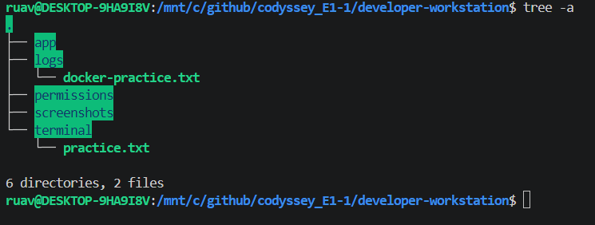
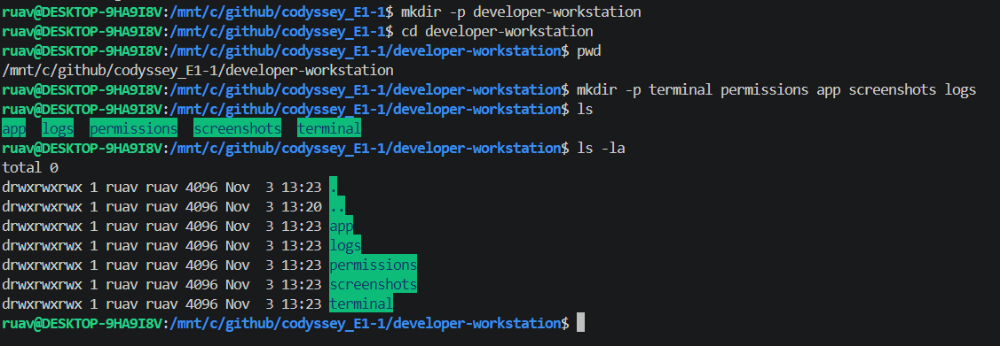
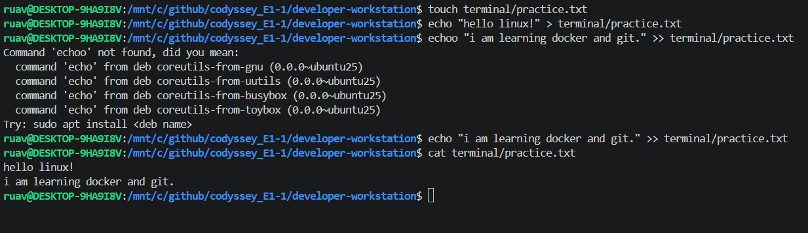
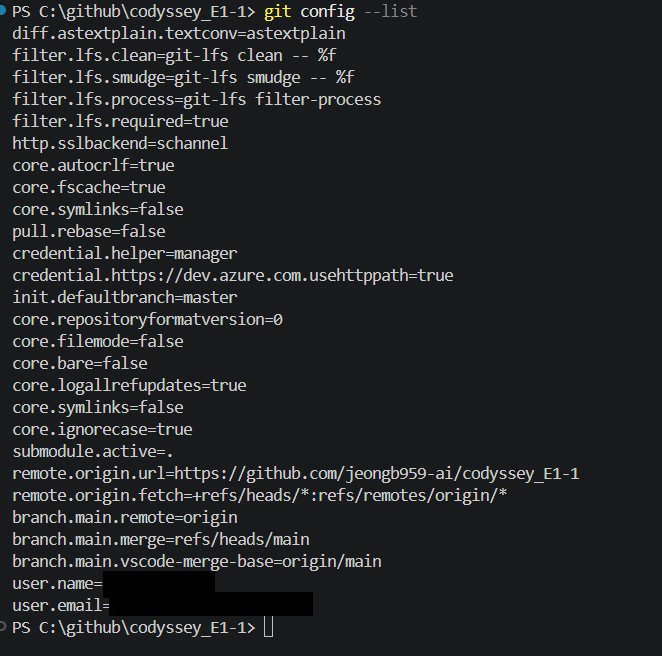
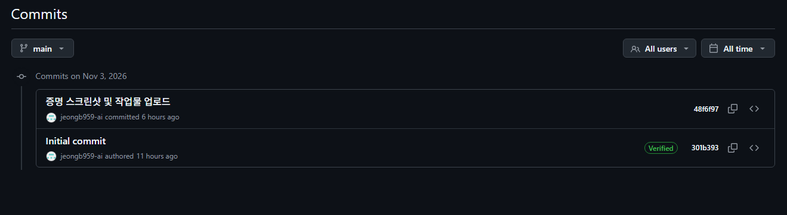

# 내 컴퓨터에 개발자용 작업실 꾸미기

리눅스 CLI, Docker, Git/GitHub를 이용해 개발 워크스테이션을 구성한 실습 기록이다. NGINX 기반 커스텀 이미지를 만들고, 포트 매핑으로 웹 페이지에 접속한 뒤 바인드 마운트의 변경 반영과 Docker 볼륨의 데이터 영속성을 확인했다.

> 실습한 내용은 명령어와 출력으로 정리하고, 직접 촬영한 스크린샷과 저장된 로그를 함께 첨부했다. 포트 매핑 접속 화면에는 주소창과 응답 화면이 포함되어 있다. 재현용 명령과 실제 관찰 결과는 구분하여 기록했다.

## 1. 실행 환경

| 항목 | 실행 환경 |
| --- | --- |
| 호스트 OS | Windows, 빌드 26100 계열 |
| Linux 환경 | WSL 2 / Ubuntu 26.04.1 LTS |
| 쉘 / 터미널 | Windows PowerShell 5.1.26100.9711 및 WSL Linux 터미널 |
| Docker | CLI / Engine 29.9.2, Docker Desktop 4.97.0 |
| Git | 2.56.0.windows.4 |
| 에디터 | VS Code 1.144.1, x64 |
| 실습 컨테이너 | ubuntu:22.04, nginx:alpine |

원본 실습 경로는 Windows의 `C:\github\codyssey_E1-1`, WSL의 `/mnt/c/github/codyssey_E1-1`이다. 다른 PC에서는 자신의 저장소 경로로 바꾼다. 아래 Linux 명령은 특별한 표시가 없으면 WSL 터미널에서 실행한다. Docker Desktop 실행 및 해당 WSL 배포판 연동이 필요하다.

## 2. 수행 체크리스트

- [x] 현재 위치, 숨김 파일 포함 목록, 디렉토리 생성 및 이동
- [x] 파일 생성, 내용 확인, 복사, 이동/이름 변경, 삭제
- [x] 파일 1개와 디렉토리 1개의 권한 변경 전후 확인
- [x] Docker 버전 및 서버 응답 확인 (`docker version`)
- [x] 이미지 다운로드/목록, 컨테이너 실행 및 전체 목록 확인
- [x] hello-world 및 Ubuntu 컨테이너 내부 명령 실행
- [x] Dockerfile 기반 커스텀 이미지 빌드
- [x] 8080/8081 포트 매핑 및 웹 접속 확인
- [x] 바인드 마운트로 호스트 파일 변경 반영
- [x] 컨테이너 삭제 후 Docker 볼륨 데이터 유지
- [x] Git 사용자 정보, 원격 저장소 설정 및 GitHub 커밋 이력 확인
- [x] Git 기본 브랜치 설정 확인 (`master`; 현재 저장소는 `main`)

## 3. 저장소 구성

```text
codyssey_E1-1/
├── README.md
├── image/                         # 실습 스크린샷
└── developer-workstation/
    ├── Dockerfile
    ├── app/index.html             # NGINX로 제공할 정적 페이지
    ├── terminal/practice.txt      # 파일 조작 결과
    ├── permissions/permission-test.txt
    └── logs/
        ├── docker-practice.txt
        ├── permission-practice.txt
        ├── web-server-practice.txt
        └── storage-practice.txt
```



빈 디렉토리는 Git에서 추적하지 않으므로, 권한 실습용 `test-directory`는 필요할 때 다시 생성한다.

## 4. 터미널 기본 조작

### 4.1 위치 확인과 디렉토리 구성

```bash
pwd
mkdir -p developer-workstation
cd developer-workstation
pwd
mkdir -p terminal permissions app screenshots logs
ls
ls -la
```

실습 출력 발췌:

```text
/mnt/c/github/codyssey_E1-1/developer-workstation
app  logs  permissions  screenshots  terminal
```



`pwd`는 현재 위치를, `ls -la`는 숨김 항목을 포함한 상세 목록을 보여준다.

절대 경로는 `/mnt/c/github/codyssey_E1-1/developer-workstation/app`처럼 루트(`/`)부터 지정한다. 상대 경로 `app/index.html`은 현재 디렉토리를 기준으로 해석한다. `cd ..`은 상위 디렉토리로 이동한다.

### 4.2 파일 생성·읽기·복사·이동·삭제

```bash
touch terminal/practice.txt
echo "hello linux!" > terminal/practice.txt
echo "i am learning docker and git." >> terminal/practice.txt
cat terminal/practice.txt
cp terminal/practice.txt terminal/practice-copy.txt
mv terminal/practice-copy.txt logs/
mv logs/practice-copy.txt logs/docker-practice.txt
touch terminal/delete-test.txt
rm terminal/delete-test.txt
```

`cat` 출력:

```text
hello linux!
i am learning docker and git.
```

`>`는 덮어쓰기, `>>`는 이어쓰기다. `cp`는 복사, `mv`는 이동 또는 이름 변경, `rm`은 삭제다. 성공한 `cp`, `mv`, `touch`, `rm`은 별도 출력 없이 프롬프트로 돌아왔다.




[파일 결과](developer-workstation/terminal/practice.txt), [복사된 로그 파일](developer-workstation/logs/docker-practice.txt)

## 5. 파일 및 디렉토리 권한

```bash
mkdir -p permissions/test-directory
touch permissions/permission-test.txt
ls -l permissions/permission-test.txt
ls -ld permissions/test-directory
chmod 644 permissions/permission-test.txt
ls -l permissions/permission-test.txt
chmod 755 permissions/permission-test.txt
ls -l permissions/permission-test.txt
chmod 644 permissions/permission-test.txt
chmod 755 permissions/test-directory
ls -ld permissions/test-directory
chmod 700 permissions/test-directory
ls -ld permissions/test-directory
chmod 755 permissions/test-directory
```

변경 전후 관찰:

```text
파일 644: -rw-r--r--
파일 755: -rwxr-xr-x
디렉토리 755: drwxr-xr-x
디렉토리 700: drwx------
```


권한은 소유자 / 그룹 / 기타 사용자 순으로 읽는다. `r=4`(읽기), `w=2`(쓰기), `x=1`(실행)을 합산하므로 `755`는 `rwx/r-x/r-x`, `644`는 `rw-/r--/r--`다. 디렉토리의 `x`는 진입 및 하위 경로 접근 권한을 뜻한다. 텍스트 파일은 최종 `644`, 디렉토리는 `755`로 되돌렸다.

[최종 권한 기록](developer-workstation/logs/permission-practice.txt). WSL의 Windows 드라이브 경로에서는 마운트 설정에 따라 권한 동작이 달라질 수 있으므로, 같은 결과가 나오지 않으면 WSL 홈 디렉토리에서도 비교한다.

## 6. Docker 기본 점검과 컨테이너 실행

### 6.1 버전 및 데몬 응답

```bash
docker --version
docker version
```

출력 발췌:

```text
Docker version 29.9.2, build a82e528
Client: Version 29.9.2
Server: Docker Desktop 4.97.0 (244584)
Engine: Version 29.9.2
OS/Arch: linux/amd64
```

Client뿐 아니라 Server 정보도 출력되어 Docker 엔진에 연결됨을 확인했다.


### 6.2 hello-world와 Ubuntu

```bash
docker run hello-world
docker run -it --name ubuntu-practice ubuntu:22.04 bash
# 아래는 Ubuntu 컨테이너 내부에서 실행
pwd
ls
echo "Hello from Ubuntu container"
cat /etc/os-release
exit
# 다시 호스트에서 실행
docker ps -a
```


Ubuntu 실습 출력 발췌:

```text
/
Hello from Ubuntu container
PRETTY_NAME="Ubuntu 22.04.5 LTS"
```

`docker run`은 이미지가 없으면 다운로드하고 새 컨테이너를 생성한다. Ubuntu의 주 프로세스인 `bash`에서 `exit`하자 `ubuntu-practice`가 `Exited (0)`으로 표시되었다. hello-world도 메시지를 출력하고 정상 종료했다. 컨테이너 종료와 이미지 삭제는 별개다.

`docker exec`는 실행 중인 컨테이너에 별도 프로세스를 실행한다. 이 실습에서는 볼륨의 파일을 읽는 데 사용했다. `docker attach`는 주 프로세스의 입출력에 연결한다.

## 7. Dockerfile 기반 웹 서버

### 7.1 베이스 이미지와 커스텀 포인트

NGINX와 Alpine Linux가 구성된 `nginx:alpine`을 베이스로 선택했다. [직접 작성한 Dockerfile](developer-workstation/Dockerfile)은 다음과 같다.

```dockerfile
FROM nginx:alpine

LABEL org.opencontainers.image.title="developer-workstation-web"

ENV APP_ENV=development

COPY app/ /usr/share/nginx/html/

EXPOSE 80
```

| 설정 | 목적 |
| --- | --- |
| `FROM nginx:alpine` | 기존 NGINX 실행 환경 재사용 |
| `LABEL` | 이미지의 프로젝트 이름 기록 |
| `ENV APP_ENV=development` | 개발 환경 값 정의. 현재 정적 HTML은 이 값을 읽지 않음 |
| `COPY app/ ...` | 기본 페이지 대신 직접 작성한 HTML 제공 |
| `EXPOSE 80` | 컨테이너 서비스 포트 문서화. 실제 호스트 공개는 `-p`로 설정 |

[웹 페이지 소스](developer-workstation/app/index.html)는 제목, 설명, 배경색, 카드 형태의 스타일을 포함한다. 현재 소스에는 바인드 마운트 실험 후의 `바인드테스트` 문구가 남아 있다.

### 7.2 빌드 및 실행

저장소 루트에서 시작한다. 이미 같은 이름의 컨테이너가 있으면 다른 이름과 사용하지 않는 호스트 포트를 지정한다.

```bash
cd developer-workstation
docker build --no-cache -t developer-workstation-web:1.0 .
docker images
docker run -d --name dev-web -p 8080:80 developer-workstation-web:1.0
docker ps
curl http://localhost:8080
```

실습 출력 발췌:

```text
[+] Building 1.3s (7/7) FINISHED
naming to docker.io/library/developer-workstation-web:1.0

IMAGE                            ID
developer-workstation-web:1.0    5a82bd0bdb55

STATUS          PORTS                                     NAMES
Up 21 minutes   0.0.0.0:8080->80/tcp, [::]:8080->80/tcp   dev-web
```


[이미지 목록·실행 상태·HTML 응답 로그](developer-workstation/logs/web-server-practice.txt)

### 7.3 포트 매핑과 브라우저 접속

`-p 8080:80`은 호스트 8080번 포트의 요청을 컨테이너의 NGINX 80번 포트로 전달한다. 컨테이너는 자체 네트워크 환경을 사용하므로 호스트에서 접근할 포트를 명시적으로 연결한다.

주소창의 `localhost:8080`과 `Hello, Docker!` 응답을 확인했다.


현재 소스로 다시 빌드하면 제목에 `바인드테스트`가 포함된다. 위 화면은 해당 문구를 추가하기 전 이미지로 실행한 결과다. `nginx:alpine`은 변경 가능한 태그이므로 재빌드 시 이미지 ID나 NGINX 버전은 달라질 수 있다.

## 8. 바인드 마운트: 호스트 변경 반영

작업 위치는 `developer-workstation`이다.

```bash
docker run -d \
  --name web-bind \
  -p 8081:80 \
  -v "$PWD/app:/usr/share/nginx/html:ro" \
  nginx:alpine
docker ps
curl -i http://localhost:8081
docker inspect web-bind --format '{{json .Mounts}}'
```

실습 응답 발췌:

```text
HTTP/1.1 200 OK
Server: nginx/1.31.8
Content-Type: text/html
```


호스트 `app/index.html`의 제목을 다음과 같이 바꾸고 브라우저를 새로고침했다.

```html
<!-- 변경 전 -->
<h1>Hello, Docker!</h1>
<!-- 변경 후 -->
<h1>Hello, Docker! 바인드테스트</h1>
```


변경 전 HTML은 [기존 응답 로그](developer-workstation/logs/web-server-practice.txt)에 기록되어 있다. 변경 후 8081 브라우저 화면에는 `바인드테스트`가 표시된다. 변경 전후는 위 HTML 코드와 응답 기록으로 비교한다.

바인드 마운트는 호스트 디렉토리를 컨테이너에 연결하므로 이미지 재빌드 없이 수정 내용이 반영된다. `:ro`는 컨테이너 측 쓰기를 막으며 호스트에서의 편집은 가능하다. `COPY`로 이미지에 넣은 파일은 호스트 파일을 수정해도 자동으로 바뀌지 않는다.

[마운트 로그](developer-workstation/logs/storage-practice.txt)에서 `Type: bind`, `Destination: /usr/share/nginx/html`, `RW: false`를 확인했다.

## 9. Docker 볼륨: 컨테이너 삭제 후 데이터 유지

볼륨 생성, 데이터 저장, 컨테이너 삭제 및 재연결 절차는 다음과 같다. 삭제 후 데이터 확인 결과를 로그와 스크린샷으로 첨부했다.

```bash
docker volume create site-data
docker run -d --name volume-test -v site-data:/data ubuntu:22.04 sleep infinity
docker exec volume-test sh -c 'echo "This data will survive container deletion!" > /data/message.txt'
docker exec volume-test cat /data/message.txt
# 실습용 컨테이너만 삭제하며 site-data 볼륨은 유지한다.
docker rm -f volume-test
docker volume ls
docker run -d --name volume-test2 -v site-data:/data ubuntu:22.04 sleep infinity
docker exec volume-test2 cat /data/message.txt
```

삭제 후 관찰한 핵심 출력:

```text
$ docker rm -f volume-test
volume-test
$ docker volume ls
DRIVER    VOLUME NAME
local     site-data
$ docker exec volume-test2 cat /data/message.txt
This data will survive container deletion!
```


[볼륨 및 데이터 로그](developer-workstation/logs/storage-practice.txt)

컨테이너를 삭제해도 별도로 관리되는 `site-data` 볼륨은 남았다. 새 컨테이너에 같은 볼륨을 `/data`로 연결하자 기존 메시지를 읽을 수 있었다. 바인드 마운트가 호스트의 특정 경로를 연결하는 방식이라면, 명명된 볼륨은 Docker가 저장 위치를 관리하는 방식이다.

## 10. Git 설정과 GitHub 연결

PowerShell에서 확인한 명령:

```powershell
git --version
git config --list
```

출력 발췌(개인 사용자 정보는 마스킹):

```text
git version 2.56.0.windows.4
init.defaultbranch=master
remote.origin.url=https://github.com/jeongb959-ai/codyssey_E1-1
branch.main.remote=origin
branch.main.merge=refs/heads/main
user.name=<마스킹>
user.email=<마스킹>
```



[제출 저장소](https://github.com/jeongb959-ai/codyssey_E1-1)

Git은 로컬에서 변경 이력과 브랜치를 관리하는 도구이고, GitHub는 원격 저장소를 공유하고 협업하는 플랫폼이다. 캡처에서는 사용자 정보, `origin`, `main`의 원격 추적 설정을 확인했다.

새 저장소의 기본 브랜치는 `master`로 설정되어 있으며, 이 저장소는 원격 `main`을 추적한다. 두 설정은 적용 대상이 다르므로 함께 존재할 수 있다. 사용자 정보는 이미지에서 마스킹했다.

### GitHub 커밋 이력

GitHub의 `main` 브랜치 커밋 목록에서 저장소 초기 생성과 실습 결과물 업로드 이력을 확인했다.

| 날짜 | 커밋 | 내용 |
| --- | --- | --- |
| 2026-11-03 | `301b393` | `Initial commit` — 저장소 초기 생성 |
| 2026-11-03 | `48f6f97` | `증명 스크린샷 및 작업물 업로드` — 실습 작업물과 증거 자료 업로드 |



Git 설정 화면의 원격 저장소 정보와 GitHub 커밋 목록을 통해 저장소 연결 설정 및 원격에 기록된 작업 이력을 확인할 수 있다.

## 11. 트러블슈팅

### 11.1 `echoo` 오타로 파일 내용 추가 실패 — 해결

- **문제:** 두 번째 줄을 추가할 때 `Command 'echoo' not found`가 출력되었다.
- **원인 가설:** `echo` 명령어를 `echoo`로 잘못 입력했다.
- **확인:** 입력값이 `echoo`였고 출력에 `Command 'echoo' not found`와 `echo` 추천 메시지가 표시되었다.
- **해결:** `echo "i am learning docker and git." >> terminal/practice.txt`로 다시 실행했다. `cat` 결과에 두 줄이 모두 표시되었다.

### 11.2 현재 브랜치와 기본 브랜치 설정 차이 — 설정 확인

- **문제:** 현재 저장소는 `main`을 추적하지만 `init.defaultbranch`는 `master`다.
- **원인 가설:** 기존 Git 전역 설정이 남아 있고, 복제한 저장소는 원격의 `main`을 사용한다.
- **확인:** [git config 캡처](image/git_config_list.png)에 `init.defaultbranch=master`와 `branch.main.merge=refs/heads/main`이 함께 있다.
- **해결 방법:** `git config --global init.defaultBranch main`을 실행하고 `git config --get init.defaultBranch`로 확인한다. 현재 저장소의 main 추적은 정상이며 기본 브랜치 이름 변경은 선택 사항이다.

### 11.3 로컬에 없는 이미지 다운로드 메시지 — 정상 동작 확인

- **상황:** Ubuntu 및 바인드 마운트 컨테이너의 첫 실행에서 `Unable to find image ... locally`가 출력되었다.
- **원인 가설:** 해당 태그의 이미지가 로컬에 없다.
- **확인:** 이어서 레이어 다운로드와 `Status: Downloaded newer image`가 출력되었다.
- **결과:** 다운로드 후 Ubuntu 쉘 실행 및 NGINX의 `HTTP/1.1 200 OK`를 확인했다. 별도 복구가 필요한 오류가 아니었다.
